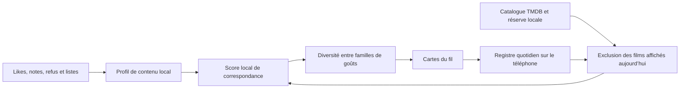

# Recommandations locales — Vela 1.9.1

Le classement du fil est un moteur de recommandation par contenu exécuté en JavaScript sur le téléphone, dans un Web Worker séparé du fil de l’interface. Les travaux périmés sont annulés lors d’un nouveau calcul ; un repli est conservé si les workers ne sont pas disponibles. Il ne fait appel à aucun serveur de calcul personnel, service d’embeddings ou API d’IA payante. TMDB reste nécessaire pour obtenir le catalogue, les métadonnées et les listes publiques de films voisins. Une réserve locale peut être reclassée sans ces requêtes.

## Profil et apprentissage

Tous les favoris, bonnes notes et réactions explicites contribuent au profil. Les séries influencent aussi le contenu préféré, bien que ce fil propose des films. Les visionnages sans note et listes à voir sont des signaux faibles ; les refus et mauvaises notes sont des exemples négatifs. Une réaction explicite plus récente garde priorité sur une ancienne note contradictoire.

La date `preferenceUpdated` distingue une modification de goût d’une simple édition de critique. Les anciennes préférences gardent au moins 80 % de leur poids ; leur fraîcheur apporte les 20 % restants avec une décroissance sur 90 jours. Les anciens fichiers sans cette date restent lisibles.

Les genres répétés sont comprimés par une racine carrée. Les couples de genres sont également comptés. Le modèle conserve tous les exemples positifs et négatifs, plutôt que trois favoris sélectionnés une fois pour toutes.

## Représentation des titres

Chaque titre devient un vecteur normalisé : genres, vocabulaire TF-IDF appris sur les synopsis/titres de la collection et des candidats, et concepts lexicaux simples (survie, espace, piratage, amitié, quête, famille, mystère…). Des mots-outils français/anglais et des pluriels fréquents sont normalisés. Les critiques privées ne font pas partie des documents analysés ou transmis à TMDB.

La proximité cosinus avec chaque exemple positif permet à un goût minoritaire de compter : une aventure proche des Goonies peut correspondre à cet exemple sans devoir ressembler aussi aux trois favoris de science-fiction. Les exemples négatifs réduisent le score des contenus proches, sans interdire arbitrairement tout un genre.

## Score et diversité

Le score combine : meilleure proximité positive (×3,5), moyenne des trois meilleures proximités (×0,65), affinité de genres (×1,6), couples de genres (jusqu’à 0,5), époque (jusqu’à 0,35), liens TMDB plafonnés (jusqu’à 0,8), qualité publique régularisée par le nombre de votes (−0,3 à +0,5), puis proximité négative (jusqu’à −3,8). Aucun pourcentage de satisfaction ou note personnelle prédite n’est annoncé.

Des favoris proches sont regroupés en familles de goûts par proximité de contenu et de genres. Trois films spatiaux proches partagent ainsi une famille. Une sélection gloutonne de type MMR pénalise la ressemblance avec les quatre dernières cartes et les répétitions de leur famille. Elle s’applique aussi à la fin de la visite précédente. Le fil ne matérialise que les 32 meilleures propositions à chaque calcul, avec exactement le même préfixe que le classement complet ; les 8 suivantes sont ajoutées aux cartes. Les explications s’appuient sur le contenu partagé et les genres ; une explication nommant un favori exige un véritable lien de voisinage TMDB.

## Acquisition et réaction aux likes

Deux références appréciées au plus sont interrogées par lot, par rotation entre tous les favoris disponibles. Les nouveaux changements de goût sont prioritaires. Une découverte large par genres est complétée par une voie ciblée sur un genre et une époque, alternant popularité et qualité publique. Les curseurs sont propres aux requêtes ; une source en panne ne saute pas sa page, et une ancienne source devenue inactive ne maintient pas artificiellement le fil ouvert.

Une réserve quotidienne de 600 métadonnées au plus et les curseurs sont stockés localement. Ce n’est pas une playlist préclassée : à chaque visite, de nouvelles sources sont interrogées et toute la réserve éligible est reclassée avec le profil actuel. Un like ou refus déclenche la recherche/recomposition de la suite sans déplacer la carte en cours ; un geste en cours se termine avant cette recomposition. Si le réseau est indisponible, les candidats déjà présents peuvent encore être proposés.

## Exclusion quotidienne stricte

Le registre, par compte, utilise la date locale du téléphone et mémorise l’identifiant et les titres/année. Il n’a pas la limite de 300 impressions de la version précédente. Seule une carte majoritairement affichée est inscrite ; les voisins préchargés ou les cartes masquées derrière une fiche ne le sont pas. Les variantes du même titre/année entre fournisseurs sont rapprochées ; les remakes d’années distinctes sont conservés.

Le registre survit aux changements d’onglet, rechargements et redémarrages tant que le stockage de l’application est conservé. À minuit local, une nouvelle journée commence. La remontée manuelle vers une carte déjà présente dans le fil reste possible ; aucun film du registre n’est réinséré comme nouvelle recommandation.

Il n’y a aucun recyclage pour remplir le fil. Après plusieurs lots sans nouveauté, une action permet de continuer la recherche avec un budget de requêtes borné. Si les sources consultées sont épuisées, une fin explicite remplace les doublons. Le registre est local à ce compte sur cet appareil ; il ne garantit pas l’exclusion après effacement des données ou sur un autre appareil. Depuis 1.7, les notifications utilisent une réserve préparée au premier plan avec le classement léger de l’accueil ; leur alarme native n’exécute pas ce moteur. Voir [notifications Android](notifications-android.md).

## Validation

Les tests couvrent les quatre favoris Who am I / Projet dernière chance / Seul sur Mars / Les Goonies, l’effet d’un nouveau like dans le parcours Explorer → fiche → Pour vous, les préférences au-delà de trois références, les synopsis de même genre, les refus, l’exclusion après plus de 300 cartes, les reprises et le passage de minuit, l’épuisement sans recyclage, le réseau coupé et les erreurs de pagination. Un cas de 600 candidats et 200 préférences contrôle les scores et relève le temps de classement sur le processeur de test. Les tests couvrent aussi l’exécution réelle du worker, la progression des minuteries d’interface pendant son travail et l’annulation d’un calcul périmé. Les API sont simulées ; le classement et l’interface sont réellement exécutés.

## Passages rapides (depuis 1.9.1)

Le suivi ne transforme jamais un scroll en note ou en refus déclaré dans la collection. Seule une carte effectivement arrêtée, visible, quittée vers la carte adjacente suivante à la suite d’un geste utilisateur (toucher, molette ou clavier) est éligible. Son temps de lecture stable doit être compris entre 350 ms inclus et 3 secondes exclues. L’animation de défilement n’est pas du temps de lecture. Un aperçu plus bref est trop ambigu et une lecture plus longue reste neutre.

Un déplacement programmatique, un geste annulé, un retour arrière, une carte préchargée, un changement d’onglet ou une mise en arrière-plan ne crée pas de signal. Ouvrir une fiche ou utiliser ses contrôles protège la carte pendant la visite. Une carte longuement lue reste protégée si l’utilisateur remonte puis la quitte à nouveau. Toute préférence explicite déjà présente (note, liste, favori, visionnage, like/refus), y compris via le même titre/année d’un autre fournisseur, prime sur le passage implicite.

Les observations sont stockées sous vela-implicit-skips-v1 par compte, séparément de la collection et du registre quotidien d’exclusion. Il y a au plus une observation par titre par jour et 120 titres conservés, avec expiration à 30 jours et demi-vie de poids de 7 jours. Un signal récent pèse entre 0,06 et environ 0,13 selon la rapidité. Aucune historique antérieur à cette version n’est converti en refus.

Le modèle soustrait la somme des proximités au cube pondérées par ces signaux, plafonnée à 0,7 point au total. La pénalité d’un refus explicite peut atteindre 3,8 points. Les passages restent séparés des genres positifs normalisés pour éviter qu’un seul faible signal ne devienne artificiellement dominant. Ils ne modifient pas les documents servant au calcul des fréquences TF-IDF, ni les graines et curseurs d’acquisition TMDB. Les choix positifs déclarés gardent leur force.

Après un signal, le worker reclasse uniquement la réserve et la suite non consultée, une fois le mouvement terminé, sans déplacer la carte en cours. La clé de classement est distincte de la clé des sources : pas de requête TMDB supplémentaire à chaque passage. La pagination normale continue lorsqu’elle est nécessaire. Les observations ne sont ni écrites dans library ni envoyées à Supabase, et ne déclenchent pas de sauvegarde de collection. L’accueil léger et les notifications conservent leur classement plus simple ; ces signaux entraînent le fil Pour vous.

Les essais couvrent les gestes réels tactiles/clavier, la persistance après rechargement, le reclassement dans le vrai worker sans appel catalogue supplémentaire, les contrôles et pauses, les limites temporelles, le retour arrière, la décroissance, l’isolation par compte, le plafonnement, la priorité des préférences explicites et l’absence de création de note/refus. Les paramètres sont des heuristiques de départ, pas un modèle validé sur une population d’utilisateurs.
